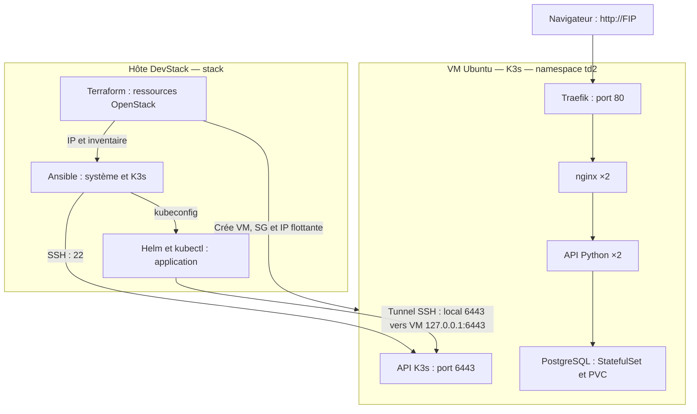
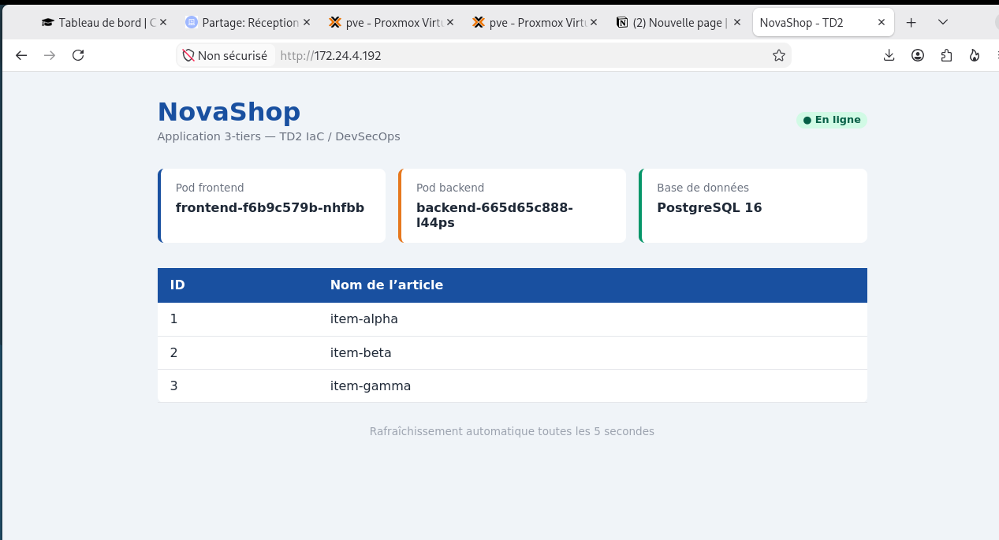

# TD2 — Industrialiser K3s avec Terraform, Ansible et Helm

**Oumayma Ennamous · 5e année · Architecture logicielle / IaC · DevStack**

NovaShop est une application 3-tiers déployée dans le namespace `td2` d’un cluster K3s mono-nœud : **nginx ×2 → API Python ×2 → PostgreSQL** avec un PVC de 1 Gi.

## Livrables

- **[Captures et correspondance avec les consignes](docs/preuves.md)** : Les captures
- code source 

## Architecture



Terraform provisionne l’infrastructure. Ansible configure la VM et installe K3s. Helm déploie les trois couches applicatives. Le Security Group autorise TCP **22, 80, 443**, sans ouvrir **6443**. Le port 443 est autorisé, mais les charts ne configurent pas de certificat TLS.

## Arborescence du projet

| Dossier / fichier | Rôle |
|---|---|
| `terraform/providers.tf` | Provider OpenStack et contrainte de version |
| `terraform/variables.tf`, `data.tf` | Paramètres et références au socle du TD1 |
| `terraform/security.tf`, `compute.tf` | Security Group, règles, VM, FIP, association Neutron |
| `terraform/outputs.tf`, `cloud-init.yaml` | Sorties Terraform et initialisation de la VM |
| `ansible/playbook.yml`, `prereq.yml`, `ansible.cfg` | Configuration et orchestration des rôles |
| `ansible/roles/k3s-prereq/`, `ansible/roles/k3s/` | Préparation du système et installation de K3s |
| `ansible/tunnel.sh` | Ouverture du tunnel SSH utilisé pendant le TD |
| `helm/postgres/` | StatefulSet, Service headless, initialisation SQL et PVC |
| `helm/backend/` | API Python, Deployment et Service |
| `helm/frontend/` | nginx, HTML/JS, Deployment, Service et Ingress |
| `docs/` | Captures de validation et index des preuves |

Terraform gère **7 ressources** : 1 groupe de sécurité + 3 règles + 1 VM + 1 IP flottante + 1 association. Le réseau, le sous-réseau, le réseau externe, l’image, le flavor et la paire de clés sont consultés via des data sources, sans être recréés.

## Contexte d’exécution et prérequis

Exécuter Terraform, Ansible, Helm et kubectl sur **l’hôte DevStack**, avec l’utilisateur `stack`. La VM `ubuntu@k3s-ennamous` est la cible d’Ansible. Le socle du TD1 doit exister : `asl-project`, `asl-net`, `asl-subnet`, `public`, `asl-key`, `ubuntu-22.04-asl`, `m1.medium`.

Outils requis : Terraform ≥ 1.6, Ansible, Helm 3, kubectl, SSH, `sshpass` pour le mode du labo, curl et Python 3. Charger les identifiants OpenStack dans le terminal :

```bash
source ~/devstack/asl-openrc
openstack token issue
```

Le dépôt contient la configuration pédagogique du labo avec des mots de passe en clair, comme lors de l’exécution capturée. Les états Terraform, fichiers `*.tfvars`, inventaire et kubeconfig sont exclus par `.gitignore`. Ne pas ajouter de credentials OpenStack ni de clés privées aux preuves publiées.

## Déploiement : ordre des opérations

**Avant de reproduire :** `ansible/playbook.yml` référence le rôle `kubeconfig`, absent du dépôt, et le script de tunnel utilise un chemin fixe. Les captures montrent un environnement fonctionnel, mais le dépôt seul ne permet pas actuellement une reproduction complète sans ces éléments.

Depuis la racine du dépôt :

```bash
terraform -chdir=terraform init
terraform -chdir=terraform plan -var='login=ennamous'
terraform -chdir=terraform apply -var='login=ennamous'
umask 077
terraform -chdir=terraform output -raw ansible_inventory > ansible/inventory.ini
(cd ansible && ansible-playbook playbook.yml)
```

Une fois le rôle manquant restauré depuis le poste de travail, le kubeconfig doit être local à l’hôte DevStack et utiliser `https://127.0.0.1:6443`. Ouvrir le tunnel dans un **terminal dédié** et le laisser actif. Le script existant suppose le projet installé dans `~/td2` ; adapter ce chemin à l’emplacement réel.

```bash
# Terminal 1 : après vérification du chemin dans ansible/tunnel.sh
bash ansible/tunnel.sh

# Terminal 2 : depuis la racine du dépôt
export KUBECONFIG="$PWD/ansible/kubeconfig"
export FIP=$(terraform -chdir=terraform output -raw floating_ip)
kubectl get nodes
helm upgrade --install postgres ./helm/postgres -n td2 --create-namespace --wait --timeout 3m
helm upgrade --install backend ./helm/backend -n td2 --wait --timeout 3m
helm upgrade --install frontend ./helm/frontend -n td2 --wait --timeout 3m
```

Le `PGDATA` du StatefulSet pointe sur `/var/lib/postgresql/data/pgdata`. Le PVC utilise la StorageClass `local-path`. Le frontend transmet `/api/` au Service backend et nginx ajoute `X-Pod-Name` à la réponse.

## Résultats attestés par les captures

| Vérification | Résultat observé | Source |
|---|---|---|
| Sorties Terraform | VM `k3s-ennamous`, FIP `172.24.4.192`, IP privée `10.10.10.33` | p. 6 |
| Ansible avec récupération kubeconfig | `ok=14 changed=1 failed=0` | p. 9 |
| Releases Helm | `backend`, `frontend`, `postgres` : `deployed` | p. 13 |
| Kubernetes | 2 pods frontend, 2 backend, 1 PostgreSQL ; PVC `Bound` | p. 13 |
| HTTP et load-balancing | HTTP 200 et deux valeurs de `X-Pod-Name` | p. 13 |
| API `/api/items` | `item-alpha`, `item-beta`, `item-gamma` | p. 13 |
| Interface NovaShop | Cards de pods, PostgreSQL et tableau des 3 articles | p. 14 |
| Terraform idempotent | `No changes` | p. 15 |
| Ansible idempotent | `ok=14 changed=0 failed=0` | p. 16 |
| Upgrades Helm | 3 releases `deployed`, révision 2 | p. 16 |
| Self-healing | Remplacement d’un pod frontend et HTTP 200 | p. 17 |



## Commandes pour vérifier sur DevStack

Ces commandes sont à exécuter avec le tunnel ouvert et `KUBECONFIG` configuré :

```bash
terraform -chdir=terraform output
terraform -chdir=terraform plan -var='login=ennamous'
(cd ansible && ansible-playbook playbook.yml)
helm list -n td2
kubectl -n td2 get pods,svc,statefulset,ingress,pvc
curl -sI "http://$FIP"
for i in $(seq 1 12); do
  curl -sI "http://$FIP" | grep -i '^X-Pod-Name:'
done
curl -s "http://$FIP/api/items" | python3 -m json.tool
```

Attendre `No changes` côté Terraform et `changed=0 failed=0 unreachable=0` côté Ansible. Les requêtes HTTP doivent montrer au moins deux noms de pods frontend ; l’alternance stricte n’est pas garantie. Comparer aussi les noms/UID des pods avant et après les trois upgrades Helm sans changement. Une nouvelle révision Helm n’implique pas nécessairement un changement des objets Kubernetes.

```bash
kubectl -n td2 get pods -o custom-columns=NAME:.metadata.name,UID:.metadata.uid
helm upgrade postgres ./helm/postgres -n td2
helm upgrade backend ./helm/backend -n td2
helm upgrade frontend ./helm/frontend -n td2
kubectl -n td2 get pods -o custom-columns=NAME:.metadata.name,UID:.metadata.uid
```


 
