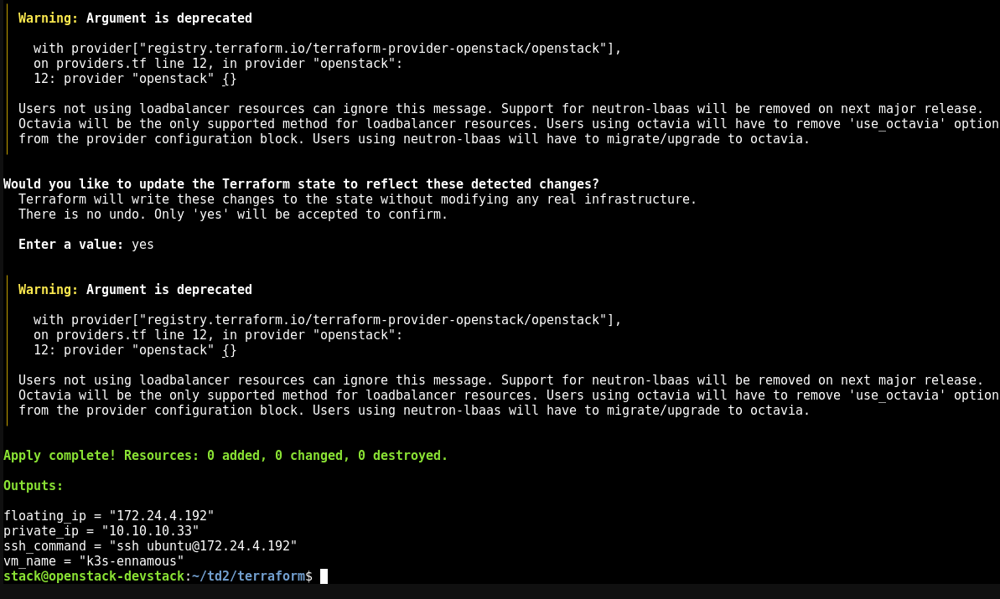
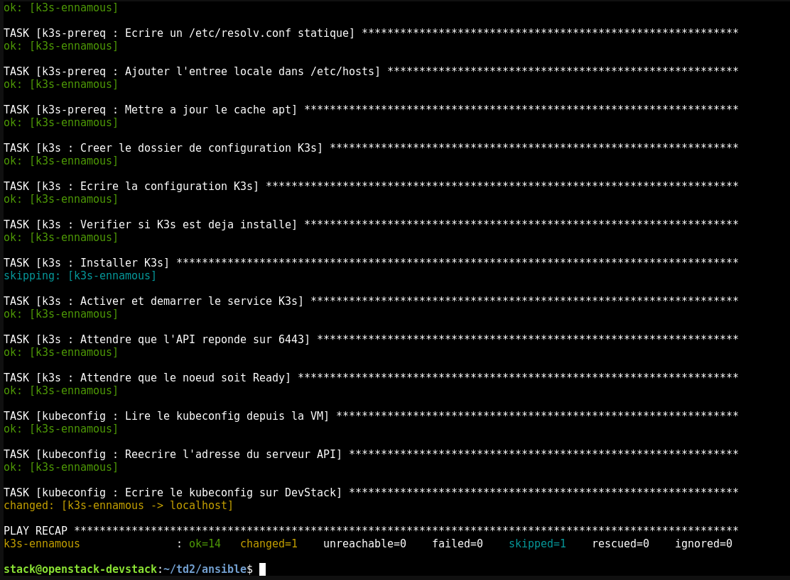
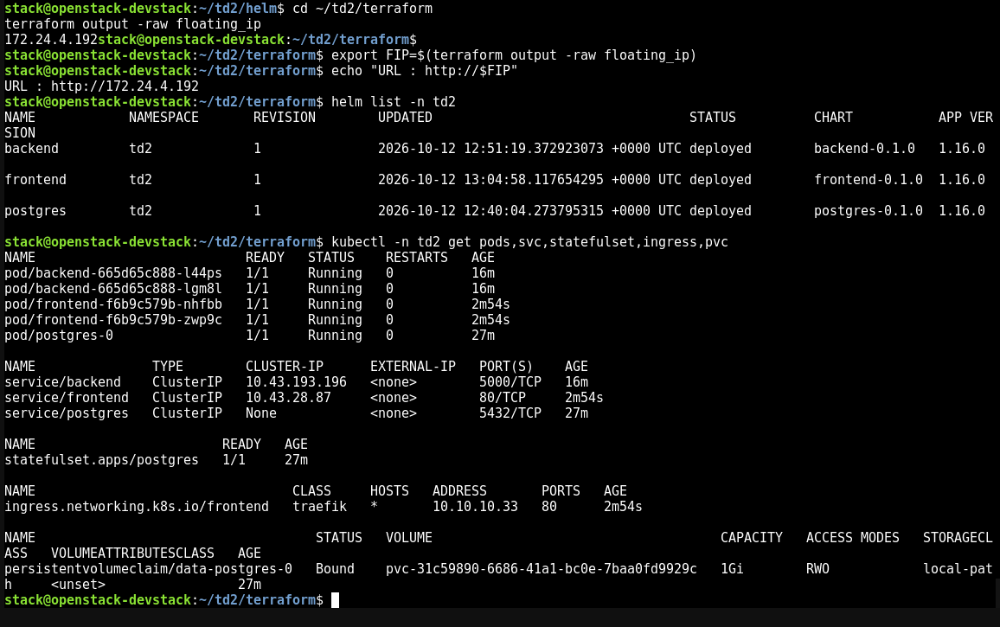
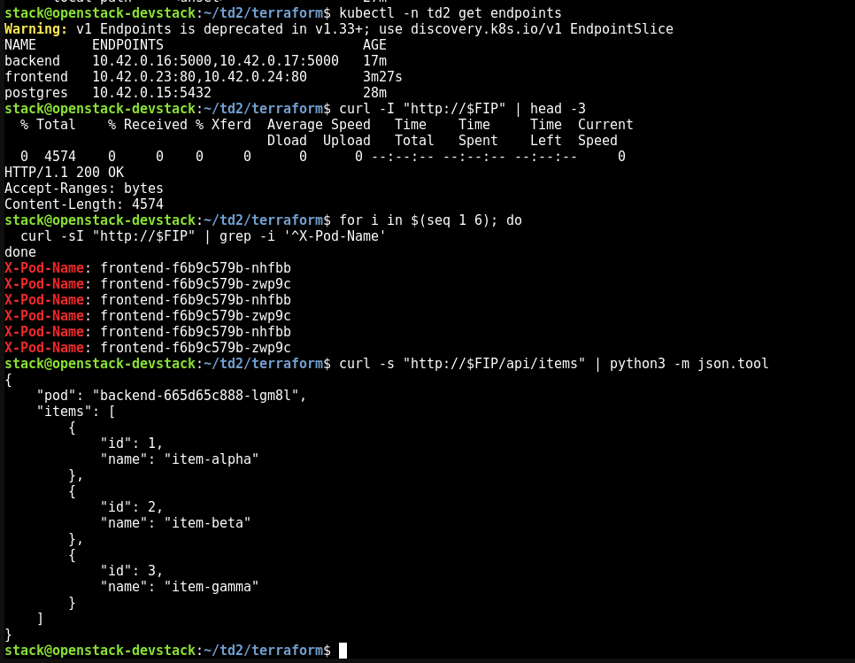
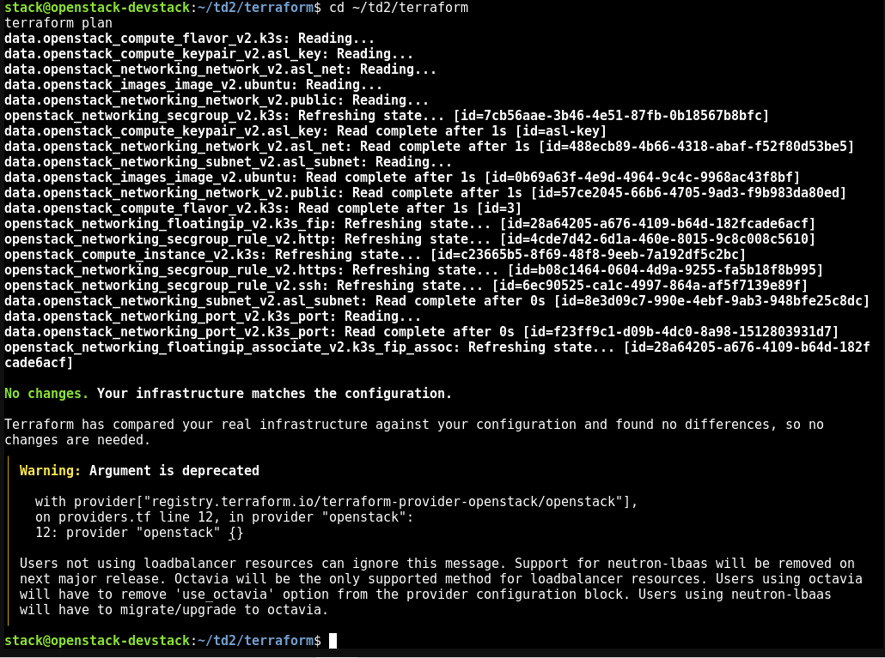
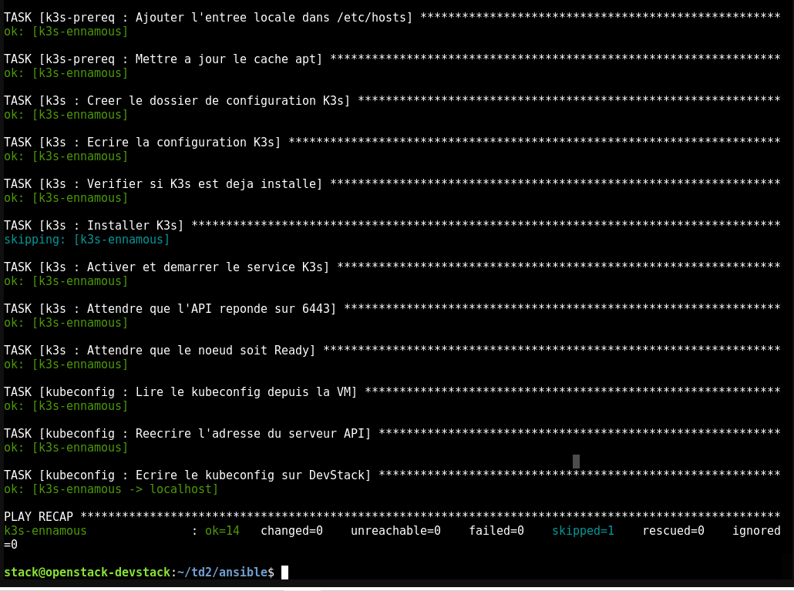
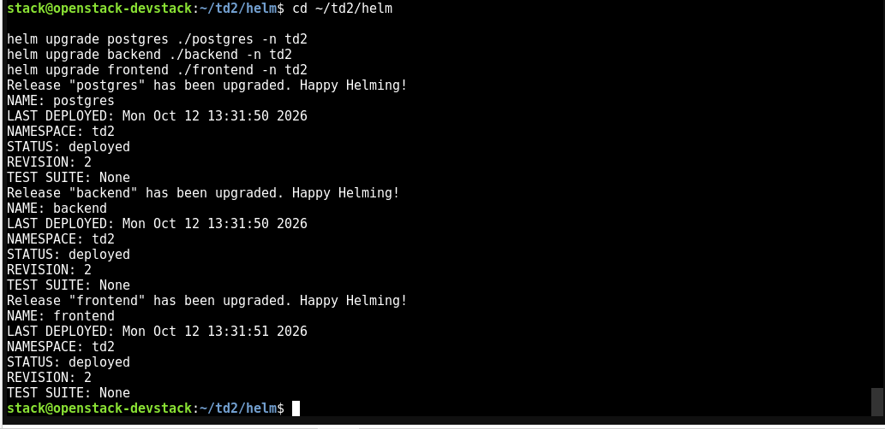
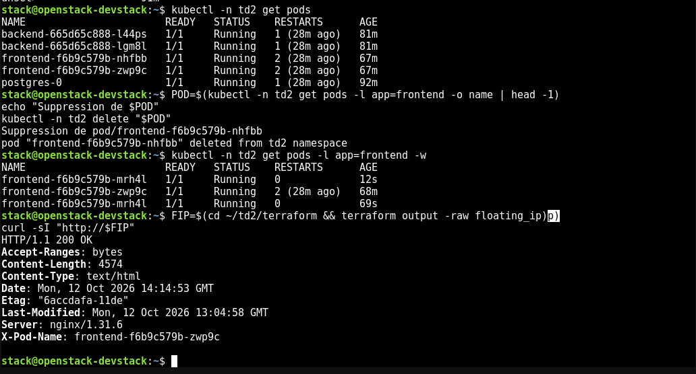

# Preuves de validation du TD2

Source : PDF de travail fourni par l’étudiante, `TD2`, **17 pages**. Les images ci-dessous ont été extraites des images embarquées, sans recréer les sorties. La numérotation renvoie aux pages de ce PDF, pas à celles de l’énoncé de 36 pages. Les captures de configuration montrant le mot de passe de la VM n’ont pas été reprises.

| Demande du professeur | Preuve disponible | Page source |
|---|---|---|
| Arborescence et architecture | README | Dépôt |
| Sorties Terraform (nom, IP, SSH) | [01 — terraform output](captures/01-terraform-output.png) | 6 |
| Premier passage Ansible avec kubeconfig | [02 — passage initial](captures/02-ansible-premier-passage.png), `ok=14 changed=1` | 9 |
| `helm list`, pods, services, Ingress, StatefulSet, PVC | [03 — Helm et Kubernetes](captures/03-helm-kubernetes.png) | 13 |
| HTTP 200, alternance `X-Pod-Name`, JSON `/api/items` | [04 — validation HTTP](captures/04-http-load-balancing-api.png) | 13 |
| Capture de l’interface NovaShop | [05 — interface](captures/05-interface-novashop.png) | 14 |
| Terraform `No changes` | [06 — idempotence Terraform](captures/06-terraform-idempotence.png) | 15 |
| Ansible `changed=0` | [07 — idempotence Ansible](captures/07-ansible-idempotence.png), `ok=14 changed=0 failed=0` | 16 |
| Trois upgrades Helm `deployed`, révision 2 | [08 — upgrades Helm](captures/08-helm-upgrade.png) | 16 |
| Self-healing frontend et HTTP 200 | [09 — self-healing](captures/09-self-healing.png) | 17 |

## Sorties relevées dans les captures

Les extraits suivants sont des **transcriptions**, pas des commandes relancées ici.

```text
floating_ip = "172.24.4.192"
private_ip = "10.10.10.33"
ssh_command = "ssh ubuntu@172.24.4.192"
vm_name = "k3s-ennamous"

PLAY RECAP (page 9)
k3s-ennamous : ok=14 changed=1 unreachable=0 failed=0 skipped=1 rescued=0 ignored=0

PLAY RECAP (page 16)
k3s-ennamous : ok=14 changed=0 unreachable=0 failed=0 skipped=1 rescued=0 ignored=0

Terraform : No changes. Your infrastructure matches the configuration.
Helm : backend, frontend, postgres — namespace td2 — STATUS deployed.
```

```text
HTTP/1.1 200 OK
X-Pod-Name: frontend-f6b9c579b-nhfbb
X-Pod-Name: frontend-f6b9c579b-zwp9c
```

```json
{
  "pod": "backend-665d65c888-lgm8l",
  "items": [
    {"id": 1, "name": "item-alpha"},
    {"id": 2, "name": "item-beta"},
    {"id": 3, "name": "item-gamma"}
  ]
}
```

Les noms/IP complets et les tableaux originaux sont lisibles dans les PNG liés. Le code existant est conservé. Le README précise les prérequis de reproduction et les preuves manquantes.

## 1. Sorties Terraform

`terraform output` : nom de la VM, IP flottante, IP privée et commande SSH. Source : p. 6.



## 2. Ansible — premier passage

Premier passage montré avec le rôle kubeconfig : `ok=14 changed=1 failed=0`. Source : p. 9.



## 3. Releases Helm et objets Kubernetes

`helm list -n td2` et `kubectl -n td2 get pods,svc,statefulset,ingress,pvc` : 3 releases déployées, 5 pods, services, Ingress et PVC Bound. Source : p. 13.



## 4. HTTP, load-balancing et API

HTTP 200, deux noms frontend dans `X-Pod-Name` et JSON de `/api/items` avec les 3 articles. Source : p. 13.



## 5. Interface web NovaShop

Interface affichant les pods frontend/backend, PostgreSQL et les trois articles. Source : p. 14.


## 6. Idempotence Terraform

`terraform plan` : `No changes. Your infrastructure matches the configuration.` Source : p. 15.



## 7. Idempotence Ansible

Second passage : `ok=14 changed=0 unreachable=0 failed=0`. Source : p. 16.



## 8. Upgrades Helm

Les trois upgrades terminent avec le statut `deployed`, révision 2. Source : p. 16. Cette capture seule ne prouve pas que tous les UID des pods sont inchangés.



## 9. Self-healing

Suppression d’un pod frontend, recréation et réponse HTTP 200. Source : p. 17.



